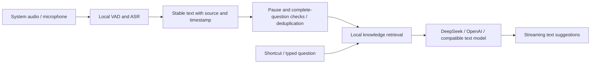

# Local ASR technical direction

First reviewed 2026-09-14. This preserves the 1.1.1 evaluation context. SenseVoiceSmall + VAD and local BGE-M3 were subsequently implemented, followed by Paraformer streaming in 1.2.2. See [local models](LOCAL_MODELS.md) for implementation and acceptance, including later Zipformer support.

## Fit for this product

LiveCopilot delivers text suggestions, not spoken AI output. The proposed next architecture was **local recognition + textual response detection + local RAG + an optional text model**, retaining OpenAI Live as an alternative. This avoids continuously uploading audio and Live session-duration charges, but local inference still consumes CPU/GPU, memory, and battery; text models and OpenAI Embeddings can still incur API fees.

`OpenAILiveProvider` does more than transcribe: it continuously interprets conversation and delegates sufficiently complete questions to local retrieval and independent analysis, including follow-ups and repeat requests. Replacing it with ASR requires an equivalent question-decision stage. VAD detects speech/pauses, not reliable semantic completion. References: [Live architecture](https://developers.openai.com/api/docs/guides/live), [delegation prompting](https://developers.openai.com/api/docs/guides/live-prompting).

Partial captions may update visually, but automatic analysis should consume stable results. Cover language switching, corrections, long pauses, rhetorical questions, and additions to the same question. Keep manual shortcuts reliable while introducing automatic decisions; do not call the answer model after every ASR chunk.

## FunASR candidates at the time

FunASR is a toolkit, not one model. Language coverage, streaming behavior, and runtimes differ.

| Candidate | Role | Boundaries to verify |
| --- | --- | --- |
| Paraformer-zh-streaming | Low-latency, primarily Chinese streaming captions | Listed for Chinese/English; long English, terms, and mixed speech need separate evaluation. Chinese results do not prove English accuracy. |
| SenseVoiceSmall + VAD | Initial local Chinese/English baseline | Mandarin/English and other languages; non-streaming by default. Short segments/sliding windows can provide incremental output; faster-than-realtime does not mean native word streaming. |
| Fun-ASR-Nano | Chinese/English/Japanese and Chinese dialect comparison | More complex model/runtime. Measure local latency, first output, and resident cost; server CUDA/vLLM speed does not transfer to Mac. |

Sources: [FunASR model list](https://github.com/modelscope/FunASR/blob/main/README_zh.md), [selection guide](https://github.com/modelscope/FunASR/blob/main/docs/model_selection.md), [SenseVoiceSmall](https://huggingface.co/FunAudioLLM/SenseVoiceSmall), [Fun-ASR-Nano](https://huggingface.co/FunAudioLLM/Fun-ASR-Nano-2512).

## macOS delivery

Evaluate models in an independent harness before stable native integration. Prefer official **C++/GGUF** or suitable ONNX, with resident local inference reusing ScreenCaptureKit/AVAudioEngine. End users should not manually install Python, PyTorch, or Docker. Download models on demand and verify version, hash, and license.

FunASR's [llama.cpp/GGUF runtime](https://github.com/modelscope/FunASR/blob/main/runtime/llama.cpp/README.md) covers SenseVoiceSmall, Paraformer, and Fun-ASR-Nano and describes standalone CPU binaries. File-oriented examples are not an already integrated LiveCopilot streaming service. Avoid per-chunk process restart/model reload; check arm64, x86_64, minimum macOS, and resources independently. A Mac GPU does not prove Metal/MPS support for the selected operators.

Remote audio sources can retain `Them` / `You` independently of model diarization. A single room microphone remains `Room`. The examined GGUF runtime did not provide CAM++ speaker clustering; do not promise per-person separation.

## Validate before switching

Compare candidates on the same human-transcribed real audio: Mandarin, long English, mixed speech, names/acronyms/numbers, quiet/noisy rooms, remote audio, and room capture. Record Chinese CER, English WER, term/number accuracy, post-speech/first-output latency, realtime factor, memory, and power. Separately count false, missed, and duplicate suggestions.

This initial review inspected documentation/code only. It did not download models or measure local ASR performance/accuracy; no unmeasured accuracy or speedup is claimed.

## Apple native APIs (integrated in 1.3.0)

macOS 26 SpeechAnalyzer/SpeechTranscriber provides on-device long-form transcription with revisable results and system-managed assets. Older SFSpeechRecognizer can require on-device recognition on supported devices/languages after checking supportsOnDeviceRecognition. See [WWDC25](https://developer.apple.com/videos/play/wwdc2025/277/) and [capability check](https://developer.apple.com/documentation/speech/sfspeechrecognizer/supportsondevicerecognition).

On 2026-09-14, SpeechTranscriber.supportedLocales on macOS 26.6.2 returned zh_CN, zh_HK, zh_TW, and English locales including en_US. That established API/language availability only, without downloading assets or validating recognition/mixed speech/latency. Integration needed runtime capability checks and existing routes for macOS 14/15.

Update 2026-09-15: SpeechAnalyzer/SpeechTranscriber was integrated, Mandarin/English models downloaded, and real local streaming/trigger tests completed. The preceding untested statement describes September 14 only. See [1.3.0](V1_3_0_UPDATE.md) for delivery, sample limits, and permission acceptance.
